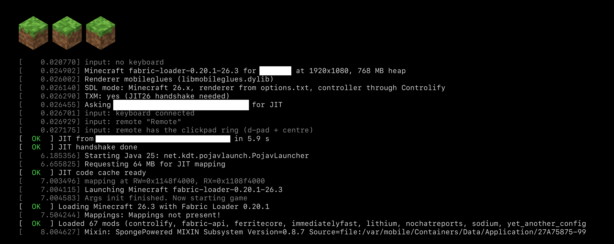

# MCTV

**NOT AN OFFICIAL MINECRAFT PRODUCT. NOT APPROVED BY OR ASSOCIATED WITH MOJANG OR MICROSOFT.**



Minecraft: Java Edition on tvOS 27, played with a game controller. Or, if you're so inclined, a keyboard and the siri remote. It's built on [Amethyst-iOS](https://github.com/AngelAuraMC/Amethyst-iOS) and runs Minecraft 26.3 with Fabric, Sodium and Controlify on Vulkan through MoltenVK.


I just wanted to play Minecraft with my kid. This repository is the culmination of that journey. Whilst this all may work for you and of course, you're welcome to try it, I hold no desire to keep this going further than my personal needs.

The repository holds no game files, code or art from Mojang. There are no prebuilt apps. You build and sign it yourself, for your own Apple TV.

## What you need

- An Apple TV 4K on tvOS 27. It's been tested on a 3rd generation with tvOS 27.2. A tvOS update can break JIT, and you can't downgrade.
- A Mac with Apple silicon, Xcode 27 with the tvOS 27.2 SDK and simulator.
- An Apple developer account for signing.
- A GitHub account with `gh auth login` done. Amethyst's Java runtime comes from its GitHub Actions build.

Java on tvOS 27 needs JIT, and tvOS 27 only allows it while a debugger prepares the memory. That happens at every launch, either from your build Mac with lldb (about 80 seconds) or from jitd on an always-on computer on your network (about 6 seconds, see [server/README.md](server/README.md)).

## Setup

```sh
git clone <this repo> mctv && cd mctv
scripts/setup.sh
```

It checks the tools, asks for your team and bundle ID prefix, checks out Amethyst and builds LWJGL, SDL and MoltenVK for tvOS.

Then:

```sh
scripts/mc-sim.sh                  # play in the simulator
scripts/mc-device.sh               # install on an Apple TV and launch it, with JIT from this Mac
scripts/mc-device.sh --jitd        # the same, with JIT from your JIT server
```

## Signing in

The app asks for a Microsoft account that owns Minecraft. The TV shows a code and a QR code. Enter the code at microsoft.com/link on your phone and the game starts. After that it goes straight in and renews the login by itself.

The simulator asks too, and keeps its login in a file, since unsigned simulator builds can't use the Keychain. So, be careful.

## Controls

- **Controller.** Any extended gamepad (Xbox, PlayStation, MFi), through the Controlify mod. Menus are driven by the D-pad and sticks, with radial menus, an on-screen keyboard and rumble.
- **Siri Remote.** Swipe to move the pointer or look around. The ring is a D-pad. In menus the centre presses the highlighted button. While playing, left and right change the hotbar slot, up jumps, down sneaks and the centre attacks. Play/Pause is right click and Back is Escape.
- **Keyboard.** A Bluetooth keyboard works as on a computer.

## Limits

- The app renders at 1920x1080, and tvOS scales it to 4K. tvOS will jetsam you at about 2.1 GB, including GPU memory, so the game gets a 768 MB heap (`-xmx` changes it). Render distance 8 and Improved Transparency fit, with about 240 MB to spare in the worst case seen.
- Going to the home screen pauses the game. tvOS suspends the app after about 30 seconds, which drops a server connection.
- Steam controllers over Bluetooth don't work, because tvOS would need a Bluetooth permission the app doesn't ask for. I also don't own one, so haven't cared to fix.

## Third party components and their licenses

Code in this repository that comes from other projects.

- [Amethyst-iOS](https://github.com/AngelAuraMC/Amethyst-iOS): [GPL-3.0](https://github.com/AngelAuraMC/Amethyst-iOS/blob/main/LICENSE).
- [StikDebug](https://github.com/StikDebug/StikDebug)'s universal JIT script, as bundled by Amethyst-iOS: [AGPL-3.0](https://github.com/StikDebug/StikDebug/blob/main/LICENSE).
- AngelAuraMC's iOS fork of [LWJGL](https://github.com/LWJGL/lwjgl3): [BSD-3-Clause](https://github.com/LWJGL/lwjgl3/blob/master/LICENSE.md).
- `jni.h` from the [Android Open Source Project](https://source.android.com): [Apache-2.0](https://www.apache.org/licenses/LICENSE-2.0).
- EGL and KHR headers from the [Khronos Group](https://github.com/KhronosGroup/EGL-Registry): MIT, in each file.
- `glfw_keycodes.h` from [GLFW](https://github.com/glfw/glfw): [zlib](https://github.com/glfw/glfw/blob/master/LICENSE.md).
- The patches in `patches/` change [SDL](https://github.com/libsdl-org/SDL), LWJGL and [MoltenVK](https://github.com/KhronosGroup/MoltenVK) and keep those projects' licenses.

## License

GPL-3.0 (`LICENSE`), since the bridge code derives from Amethyst-iOS. `tools/jit26.py` and `server/jitd/session.py` are AGPL-3.0 (`LICENSE.AGPL`), since they port StikDebug's JIT script. GPL-3.0 allows the two to be combined, as in jitd. `mctv/sdl` is under SDL's zlib license, since it's built into SDL. The headers in `mctv/Sources/bridge/include` keep their own licenses.

Thanks to Amethyst-iOS, PojavLauncher and StikDebug, and to everyone above.
